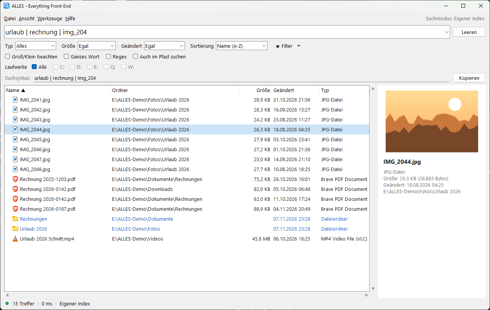
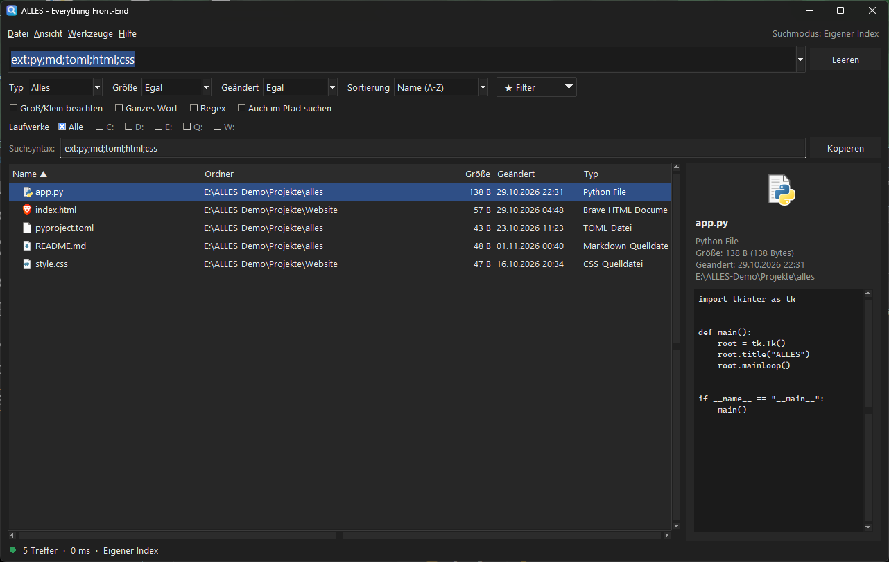
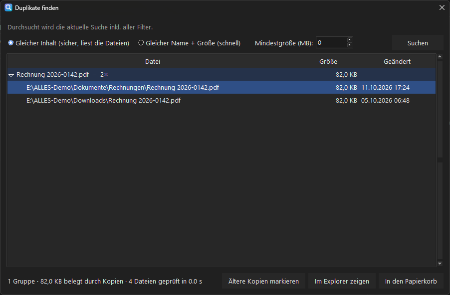
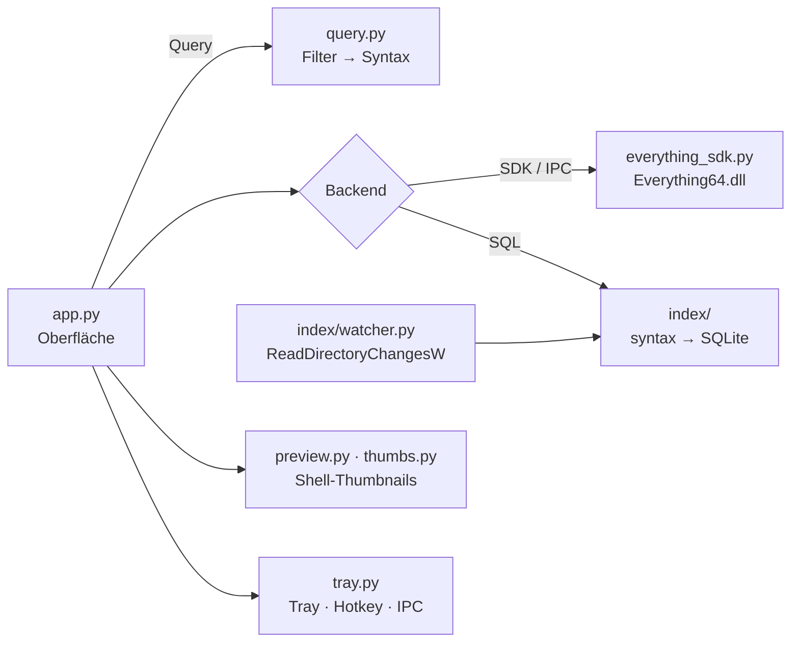

<div align="center">


# ALLES

**Blitzschnelle Dateisuche für Windows – mit [Everything](https://www.voidtools.com) oder ganz ohne.**

[](https://github.com/theStxve/alles/releases/latest)
[](https://github.com/theStxve/alles/releases)
[](https://github.com/theStxve/alles/actions/workflows/ci.yml)
[](LICENSE)
<br>


[**Download**](https://github.com/theStxve/alles/releases/latest) ·
[Funktionen](#funktionen) ·
[Installation](#installation) ·
[Tastenkürzel](#tastenkuerzel) ·
[FAQ](#faq)



</div>

---

## Warum ALLES?

*Everything* von voidtools ist die schnellste Dateisuche für Windows. Viele scheitern aber an
der Suchsyntax, wundern sich über fehlende Laufwerke oder wollen einfach nur klicken statt
`ext:pdf;docx dm:lastweek size:>1mb` zu tippen.

**ALLES** legt eine aufgeräumte Oberfläche darüber:

- Du **klickst Filter an**, ALLES schreibt die passende Suchsyntax und zeigt sie dir an. So lernst du sie nebenbei.
- Mit dem **eigenen Index** funktioniert ALLES auch **komplett ohne Everything**. Der Index liest
  sogar Laufwerke, die Everything nicht automatisch erfasst (exFAT, USB, Netzlaufwerke).
- **Vorschau, Duplikat-Finder, Dark Mode, Explorer-Integration**: alles in einer kleinen, portablen EXE.

<a id="funktionen"></a>

## Funktionen

| | |
|---|---|
| **Live-Suche** | Ergebnisse beim Tippen, veraltete Anfragen werden abgebrochen |
| **Zwei Suchmodi** | Everything 1.4 **und 1.5** (voidtools) **oder** eigener Index, wahlweise automatisch |
| **Such-Assistenten** | Autovervollständigung für die Syntax, „pdfs von letzter woche“ → Syntax, Tippfehler-Vorschläge |
| **Inhaltssuche** | Text *in* Dateien finden (UTF-8, UTF-16, ANSI) – mit Everything und dem eigenen Index |
| **Filter per Klick** | Typ, Größe, Datum, Laufwerke, Sortierung, Groß/Klein, Regex, Pfadsuche |
| **Filter-Presets** | Eingebaute Vorlagen, eigene Filterkombinationen speicherbar |
| **Vorschau** | Explorer-Thumbnails für Bilder/Videos/PDFs, Textinhalt für Code und Notizen |
| **Duplikat-Finder** | Nach Inhalt (Hash) oder Name+Größe, ältere Kopien mit einem Klick in den Papierkorb |
| **Ordner ausschließen** | `node_modules`, `.git`, `WinSxS` & Co. bleiben draußen, frei einstellbar |
| **Dark Mode** | Folgt Windows oder fest hell/dunkel, inklusive dunkler Titelleiste |
| **Explorer-Integration** | Rechtsklick auf einen Ordner → *Mit ALLES durchsuchen* |
| **Globaler Hotkey** | `Strg+Alt+Leertaste` holt ALLES von überall nach vorn (frei belegbar) |
| **Echte Datei-Icons** | Icons und Typnamen direkt aus Windows |
| **Dateiaktionen** | Öffnen, Öffnen mit…, Explorer, Terminal, VS Code, Eigenschaften, Papierkorb, Kopieren/Verschieben nach … |
| **Windows-Kontextmenü** | Umschalt+Rechtsklick öffnet das echte Explorer-Menü mit 7-Zip, Git, „Senden an“ & Co. |
| **Umbenennen** | F2 – auch für viele Dateien auf einmal, mit Platzhaltern, Vorschau und Rückgängig |
| **Endloses Scrollen** | Weitere Treffer werden beim Scrollen automatisch nachgeladen |
| **Auto-Update** | Neue Versionen werden erkannt, geprüft (SHA-256) und mit einem Klick installiert |
| **Deutsch & Englisch** | Sprache folgt Windows oder ist frei wählbar |
| **CSV-Export** | Ergebnislisten Excel-kompatibel exportieren |
| **Diagnose & Selbstheilung** | Zeigt nicht indizierte Laufwerke und startet Everything bei Bedarf neu |
| **Portabel** | Ein `ALLES-Daten`-Ordner neben der EXE: alles bleibt auf dem USB-Stick |

### Zwei Suchmodi

| | Everything | Eigener Index |
|---|---|---|
| Voraussetzung | Everything 1.4 oder 1.5 installiert und gestartet | keine |
| Erster Start | sofort | einmaliges Einlesen (ca. 1 Min. pro 1–2 Mio. Dateien) |
| Suchgeschwindigkeit | < 50 ms | 10–200 ms |
| Laufwerke | NTFS automatisch, andere manuell | alles, was du auswählst (auch exFAT, USB, Netzwerk) |
| Aktualisierung | live (NTFS-Journal) | live (Ordnerüberwachung) und beim Start |
| Adminrechte | nein | nein |

Im Modus **Automatisch** (Standard) nutzt ALLES Everything, wenn es installiert ist, und sonst den eigenen Index.

<div align="center">


</div>

<a id="installation"></a>

## Installation

### Installer (empfohlen)

[**ALLES-Setup-x.y.z.exe**](https://github.com/theStxve/alles/releases/latest) herunterladen und
starten. Der Installer braucht **keine Adminrechte**. Er legt einen Startmenü-Eintrag an und
fragt optional nach Desktop-Icon, Autostart und Explorer-Kontextmenü. Deinstallieren lässt sich
ALLES ganz normal über *Einstellungen → Apps*.

### Portabel

`ALLES-x.y.z-portable.zip` entpacken und `ALLES.exe` starten. Der mitgelieferte Ordner
`ALLES-Daten` sorgt dafür, dass Einstellungen und Index dort landen und nicht im Benutzerprofil.

### Aus dem Quellcode

```powershell
git clone https://github.com/theStxve/alles.git
cd alles
python scripts/fetch_sdk.py   # optional: Everything-SDK für den Everything-Modus
python run_alles.py           # oder: pythonw run_alles.py (ohne Konsole)
```

Voraussetzung: Python 3.10+ mit tkinter (im offiziellen Installer enthalten). Es gibt **keine**
weiteren Abhängigkeiten.

> **SmartScreen:** Die EXE ist (noch) nicht signiert. Windows kann deshalb warnen: *Weitere
> Informationen → Trotzdem ausführen*. Jedem Release liegen SHA-256-Prüfsummen bei.

<a id="tastenkuerzel"></a>

## Tastenkürzel

| Taste | Aktion |
|---|---|
| `Strg+Alt+Leertaste` | Fenster ein-/ausblenden (global, änderbar) |
| `Strg+F` / `Strg+L` | Suchfeld fokussieren |
| `↓` / `↑` | Zwischen Suchfeld und Ergebnissen wechseln |
| `Enter` · `Strg+Enter` · `Alt+Enter` | Öffnen · Im Explorer zeigen · Eigenschaften |
| `Strg+T` | Terminal im Ordner öffnen |
| `F2` · `Strg+Z` | Umbenennen · Umbenennen rückgängig |
| `Umschalt+Rechtsklick` | Windows-Kontextmenü |
| `Tab` | Syntax-Vorschlag übernehmen |
| `Entf` | In den Papierkorb |
| `Strg+C` · `Strg+Umschalt+C` | Pfade · Namen kopieren |
| `Strg+P` | Vorschau ein/aus |
| `Strg+S` | Als CSV exportieren |
| `F5` · `Esc` · `Strg+Q` | Neu suchen · Leeren/in den Tray · Beenden |

## Suchsyntax

Die Filter erzeugen die Syntax automatisch. Du kannst sie aber auch direkt tippen, und sie
funktioniert in **beiden** Suchmodi:

| Syntax | Bedeutung | Beispiel |
|---|---|---|
| Leerzeichen | UND | `rechnung 2026` |
| `\|` | ODER | `jpg \| png` |
| `!` | NICHT | `bericht !entwurf` |
| `< >` | Gruppe | `<jpg \| png> urlaub` |
| `" "` | genaue Phrase | `"mein ordner"` |
| `*` `?` | Platzhalter | `*.pdf` · `scan_??.jpg` |
| `\` | im Pfad suchen | `\projekte\ angebot` |
| `ext:` | Dateiendung | `ext:pdf;docx` |
| `size:` | Größe | `size:>100mb` · `size:1mb..5mb` |
| `dm:` | Änderungsdatum | `dm:today` · `dm:lastweek` · `dm:2025` |
| `file:` · `folder:` | nur Dateien/Ordner | `folder:backup` |
| `parent:` | direkt in Ordner | `parent:C:\Users` |
| `regex:` | regulärer Ausdruck | `regex:^IMG_\d+\.jpg$` |
| `content:` | Text im Dateiinhalt | `ext:txt content:"angebot"` |

<a id="faq"></a>

## Häufige Fragen

<details>
<summary><b>„Everything läuft nicht (oder nur als Dienst)“</b></summary>

Der Everything-*Dienst* allein beantwortet keine Suchanfragen, dafür muss `Everything.exe`
laufen. ALLES startet es automatisch im Hintergrund. Klappt das nicht, gib den Pfad unter
*Werkzeuge → Einstellungen → Everything* an, oder wechsle zum eigenen Index.
</details>

<details>
<summary><b>Ein Laufwerk liefert keine Treffer</b></summary>

*Werkzeuge → Diagnose* zeigt, welche Laufwerke nicht im Index sind. Everything indiziert
FAT/exFAT- und Netzlaufwerke nicht automatisch. Du kannst sie in Everything als Ordner-Index
hinzufügen oder den **eigenen Index** nutzen und das Laufwerk unter *Einstellungen → Eigener
Index* auswählen.
</details>

<details>
<summary><b>Wie aktuell ist der eigene Index?</b></summary>

Änderungen werden live über die Windows-Ordnerüberwachung übernommen, neue Dateien sind also
nach etwa einer Sekunde findbar. Was passiert, während ALLES nicht läuft, holt ein
Hintergrund-Abgleich beim nächsten Start nach (einstellbar). Während des Abgleichs bleibt der
alte Index durchsuchbar.
</details>

<details>
<summary><b>Wo liegen Einstellungen, Index und Log?</b></summary>

- Einstellungen und Log: `%APPDATA%\ALLES\`
- Suchindex: `%LOCALAPPDATA%\ALLES\index.db`
- Im portablen Modus liegt alles im Ordner `ALLES-Daten` neben der EXE.
</details>

<details>
<summary><b>Ist ALLES ein offizielles voidtools-Produkt?</b></summary>

Nein. ALLES ist ein unabhängiges Open-Source-Projekt und nutzt Everything über dessen
offizielles SDK. Everything selbst ist nicht Teil dieses Projekts.
</details>

## Entwicklung

```powershell
pip install -e ".[dev]"
python -m ruff check .
python -m pytest                           # ~100 Tests
powershell -File scripts\build.ps1         # EXE, portable ZIP und (mit Inno Setup) Installer
```



| Modul | Aufgabe |
|---|---|
| `alles/app.py` | Hauptfenster, Such-Worker, Status, Presets |
| `alles/query.py` | UI-Auswahl → Everything-Syntax |
| `alles/backends.py` | Gemeinsame Schnittstelle für Everything und eigenen Index |
| `alles/index/` | Syntax-Parser → SQL, SQLite-Speicher, Scanner, Live-Überwachung |
| `alles/preview.py`, `thumbs.py` | Vorschau, Explorer-Thumbnails und Icons (reines ctypes) |
| `alles/tray.py` | Tray-Icon, globaler Hotkey, Single-Instance und Instanz-Kommunikation |
| `alles/shell.py` | Explorer, Papierkorb, Terminal, Autostart, Kontextmenü |
| `alles/dialogs.py` | Einstellungen, Duplikat-Finder |
| `installer/alles.iss` | Inno-Setup-Installer |

**Release:** Version in `alles/__init__.py` erhöhen, dann
`git tag v2.1.0 && git push --tags`. GitHub Actions testet und baut EXE, Installer und portable
ZIP, prüft den Installer per Test-Installation und hängt alles an das Release.

Ideen und Roadmap: [docs/FEATURE_IDEAS.md](docs/FEATURE_IDEAS.md) · Änderungen: [CHANGELOG.md](CHANGELOG.md)

## Lizenz

[MIT](LICENSE) © theStxve

„Everything“ und das Everything-SDK sind Produkte von [voidtools](https://www.voidtools.com).
Sie sind nicht Teil dieses Repositories. ALLES ist mit voidtools nicht verbunden.
